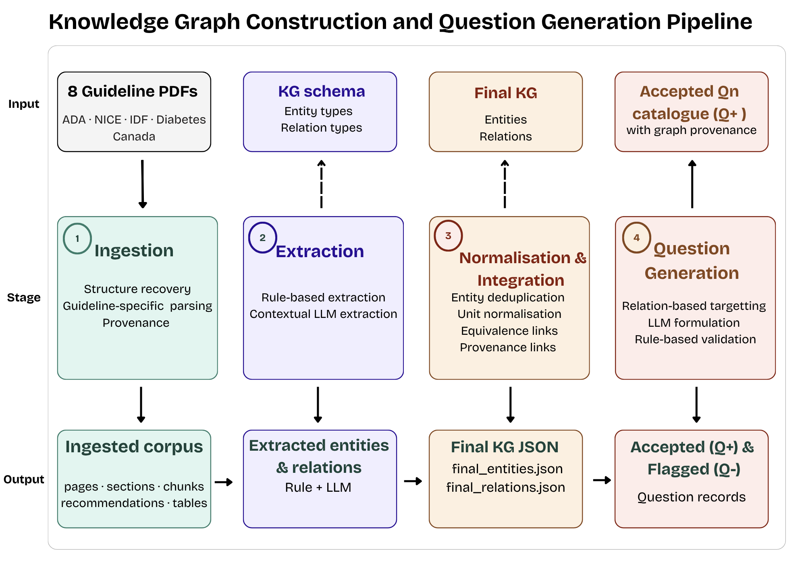

# Diabetes Guideline Knowledge Graph

This repository contains the code developed for my Master's thesis. The project explores how clinical guidelines from different organisations can be brought together in a knowledge graph and used to generate educational questions.

## Pipeline

The pipeline has four main stages:

1. **Document ingestion** – converts PDF guidelines into structured records.
2. **Information extraction** – identifies relevant clinical entities and relationships using rule-based and LLM-based methods.
3. **Normalisation** – standardises entities and measurement units, and identifies equivalent numerical targets across guidelines.
4. **Question generation** – uses graph relationships to generate and validate educational questions.

The pipeline architecture is shown below.



## Repository contents

- `src/` – Python scripts for the pipeline stages.
- `config/` – schema, ontology and extraction patterns.
- `data/` – input data and samples.
- `outputs/` – generated graph data and questions.
- `docs/` – architecture diagram and supporting documentation.

## Requirements

Install the required Python packages:

```bash
pip install -r requirements.txt
```

Create a `.env` file using `.env.example` as a starting point and add the required API and database credentials.

## Notes

The pipeline was developed and evaluated using eight diabetes guideline documents from four organisations. The architecture can be adapted to other clinical domains, although the extraction rules and normalisation logic would need to be adjusted.

The thesis and presentation are included in this repository for further context.